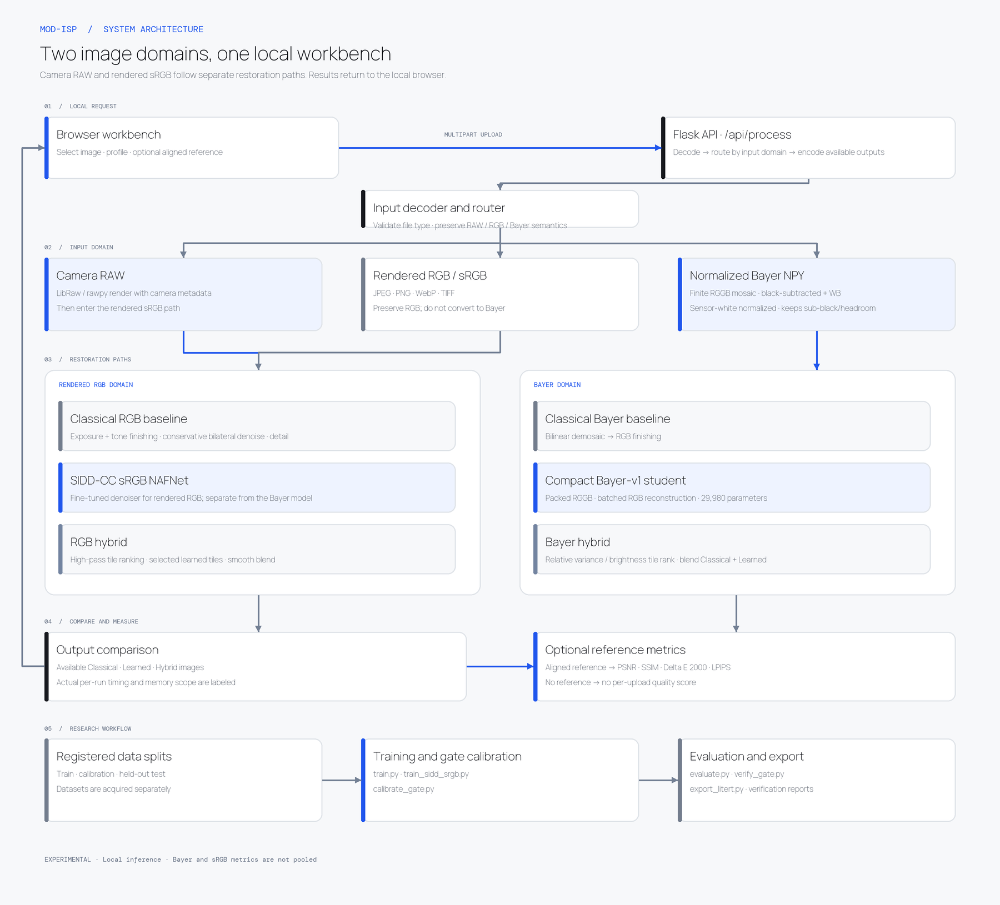

# MOD-ISP workbench

A local experimental Bayer-to-RGB workbench based on the MOD-ISP proposal. It contains classical demosaicing, a compact trainable Haar-wavelet attention network, reference metrics, paired-data training, distillation, LiteRT INT8 export, and held-out evaluation. Its Bayer Hybrid path has an experimental RAW-statistics tile gate. The latest full-SIDD-CC-train gate evaluation routed 100% of held-out tiles and was slower than Learned; no quality-safe efficiency gain has been established. See [the full-train and RAW gate report](docs/siddcc-fulltrain-gate-evaluation.md).

The Vercel production page at [mod-isp-workbench.vercel.app](https://mod-isp-workbench.vercel.app/) combines a fixed, measured SIDD-CC comparison with browser-side inference for unseen JPEG/PNG/WebP images. The image is resized to a 1024 px long edge and processed on-device with the fine-tuned sRGB model; image pixels are not uploaded. Bayer RAW and normalized Bayer NPY processing remain in the local Python workbench. Hosted Hybrid is a spatial blend after full Learned inference and makes no compute-saving claim.

## Installation and launch

Use Python 3.10–3.12. For a local inference/demo run, install the runtime dependencies and launch with one command:

```sh
./run_local.sh
```

It creates `.venv` if needed, installs `requirements-runtime.txt`, and starts the app at http://127.0.0.1:5050. For training, evaluation, distillation, and LiteRT export, install the full research dependencies instead:

```sh
python3 -m venv .venv
source .venv/bin/activate
pip install -r requirements.txt
python app.py
```

Open http://127.0.0.1:5050. The landing page runs rendered-RGB inference in the browser; open http://127.0.0.1:5050/workbench for camera RAW and normalized Bayer NPY processing. The local server binds to loopback. Bayer-workbench uploads are limited to 30 MB. RGB images above 16 megapixels are resized proportionally; RAW and NPY Bayer inputs above 16 megapixels are rejected to preserve sensor mosaic handling. Camera RAW support uses LibRaw and camera metadata; the workbench keeps LibRaw's camera-managed render for unknown cameras, then applies the separately trained sRGB denoiser. Unsupported sensor mosaics fail explicitly. `.npy` input for the Bayer model is a 2-D float array in RGGB order, black-subtracted and white-balanced, normalized to sensor white level, with unclipped values accepted in [-0.5, 8] to preserve sub-black noise and white-balance headroom. JPEG/PNG/WebP/TIFF remain rendered RGB and use the separate sRGB denoiser. They are never mosaiced or sent to the Bayer model. Odd Bayer dimensions are cropped to even values.

### One-command container run

Docker provides a CPU inference/demo image. Build and run it from this directory:

```sh
docker build -t mod-isp .
docker run --rm -p 127.0.0.1:5050:5050 mod-isp
```

Then open http://127.0.0.1:5050. The port is published on loopback by default. The image includes the local inference checkpoints and a pinned, license-preserved copy of Samsung's NAFNet architecture, but excludes datasets and teacher weights. Training, evaluation, and LiteRT conversion use the full host requirements and scripts below. The Docker image has not been built in this workspace because Docker is not installed; see `CONTAINER_NOTICE.md` for its scope and the upstream license notice.

## Project documents and evaluation

- [System architecture diagram](docs/architecture.md)
- [Model and implementation design](docs/model-design.md)
- [Ablation study](docs/ablation-study.md)
- [Held-out sRGB robustness analysis](docs/robustness-analysis.md)
- [Failure-case analysis](docs/failure-case-analysis.md)
- [IJCAI 2024 MetaISP paper reproduction and distillation protocol](docs/metaisp-2024-reproduction.md)
- [Full SIDD-CC RAW training and held-out gate evaluation](docs/siddcc-fulltrain-gate-evaluation.md)
- [Hackathon readiness and dataset-coverage audit](docs/hackathon-readiness-audit.md)
- [Tile-gate calibration and held-out evaluation](tile_gate_evaluation.json)
- [Current actual selective-inference gate evaluation](tile_gate_runtimeaware_validation.json)
- [iPhone SE DNG API verification](raw_dng_verification.json)
- [Comparative evaluation report](eval_probID_TeamID.md) — problem P2 is known; replace the filename placeholder after the assigned team ID is available.
- [Three-minute demo and viva runbook](docs/demo-viva-runbook.md) — measured claims, known failure case, and required public-deployment checks.
- [Visual design system](DESIGN.md)
- [Hosted showcase implementation and deployment notes](VERCEL.md)

The local datasets and original MetaISP teacher checkpoint are not included. Evaluation JSONs retain measured metrics with workspace-specific absolute paths normalized. The static showcase assets are generated from the fixed held-out sample and the current checkpoints by scripts/build_static_showcase_assets.py; they are not fabricated mockups.

### Browser-side RGB inference

The static judge page runs the SIDD-CC sRGB NAFNet in ONNX Runtime Web/WASM, using 256×256 tiles with overlap blending. The browser model and runtime are self-hosted; first use downloads about 16 MB of model/runtime assets. Inputs are restricted to JPEG, PNG, and WebP, up to 30 MB, then resized to at most 1024 px on the long edge. This is a demonstration path for rendered sRGB, not a RAW Bayer ISP or calibrated camera pipeline. The Learned output applies the same exposure/tone finishing used by the local RGB path. The Classical path uses an exposure/tone transform, a small bilateral filter, and sharpening; Hybrid blends Classical and Learned by tile-level high-pass score after all Learned tiles have already been inferred, so it does not reduce computation. Quality metrics are omitted unless an aligned reference is available. Model and runtime license details are shown at the page footer and in static/showcase/MODEL-NOTICE.md.

Re-export and compare the browser model with PyTorch using the full research environment:

```sh
.venv312/bin/python export_srgb_onnx.py --out static/showcase/nafnet-srgb.onnx
.venv312/bin/python verify_srgb_onnx.py --out onnx_verification_srgb.json
python3 scripts/build_vercel_site.py
```

The recorded fixed-seed CPU parity check has 1.57e-6 mean absolute error, 1.36e-5 p99, and 4.47e-4 maximum error for a 256×256 input. It checks graph conversion fidelity, not restoration quality; see onnx_verification_srgb.json and browser_inference_smoke.json for separate evidence.

## Implemented architecture

This diagram describes the current code paths. It does not describe unimplemented blueprint targets such as a camera-calibrated CCM, a learned noise estimator, or mobile NPU execution.



Camera RAW files are demosaiced and color-rendered through LibRaw, which applies embedded DNG camera metadata. The available SIDD-CC sRGB denoiser then operates on that rendered image; the Bayer-trained checkpoint is not applied to cameras it was not calibrated on. Normalized Bayer NPY files use the Bayer model. Their Hybrid path selectively infers tiles using an experimental RAW-statistics gate. After switching the Bayer classical renderer to MHC demosaicing, the currently loaded production-checkpoint gate was reverified on the same 36-capture validation scene: it routes 77.6% of tiles, loses 1.168 dB PSNR, and is slower (23.9 ms Hybrid vs 18.4 ms Learned median warm). A newly calibrated 512px ExtraTrees policy for the production checkpoint lost 0.552 dB and routed 99%; its 256px Ridge counterpart lost 1.864 dB and routed 96%. The separate 2024-inspired-student MHC + ExtraTrees gate lost 0.440 dB but routes 99% and runs slower (89.1 vs 38.5 ms). A separate full-SIDD-CC-train test-block gate check routed 100% and measured 46.44 ms Hybrid vs 19.25 ms Learned mean warm. No candidate demonstrates a quality-safe efficiency win. Results and caveats are in the [gate experiments](docs/metaisp-2024-reproduction.md) and [full-train RAW report](docs/siddcc-fulltrain-gate-evaluation.md). Bayer and sRGB learned models are separate checkpoints and were trained/evaluated on different data domains.

For RGB and camera-RAW three-path comparisons, the Learned output's sRGB tile predictions are reused to compose Hybrid. Those Hybrid times are **incremental comparison costs**, not standalone inference. Normalized Bayer Hybrid instead runs selected tiles as a separate inference path; its latency includes gate features, selective model inference, and blending. The HTTP request wall time is the complete time to produce and encode all three results.

When a camera RAW file is processed, the workbench also displays a RAW sensor record with the reported camera/CFA, black and white levels, as-shot white-balance gains, matrix-use status, LibRaw renderer, and observed sample fractions at the black/white boundaries. Black levels and gains are reported in the decoder's RGGB-normalized order; the CFA label records the source pattern. The clipping check is a simple fraction of decoded visible mosaic samples within one code value of the corresponding black or white level; the 1% note is a review threshold, not a camera clipping standard. Noise is explicitly marked as uncalibrated. RGB and NPY inputs do not show this camera-specific record. It is provenance and a sanity check, not a learned sensor-noise estimate or proof of RAW image quality.

## Data and training

Use separately collected and registered training, calibration and held-out test sets. Each has `input/` and `target/` directories. Pair files by matching stem: input can be camera RAW, normalized RGGB `.npy`, or an RGB image for Bayer-simulation training; target is RGB PNG/JPEG/TIFF with identical dimensions. RGB-to-Bayer mosaicing in the training utility is synthetic data augmentation only. It does not make an RGB image sensor RAW and must not be used for real-camera RAW evaluation. The live workbench keeps JPEG/PNG in RGB and sends them to the separate sRGB denoiser. RAW targets must already be geometrically aligned and color matched. Dataset access and licenses are the user's responsibility. Keep test data out of training and calibration.

```sh
python train.py --data data/train --epochs 10 --patch 128 --out models/mod_isp.pt
python train.py --data data/train --teacher models/teacher.pt --epochs 10 --out models/student.pt
python evaluate.py --data data/test --checkpoint models/mod_isp.pt --out evaluation.json
python export_litert.py --checkpoint models/mod_isp.pt --calibration-data data/siddcc_bayer/calibration --out models/mod_isp_int8.tflite
```

Training is deterministic given the same software/hardware and `--seed` where supported. The teacher may be a compatible `bayer-v1` checkpoint, or a separately supplied TorchScript model selected with `--teacher-format torchscript`. A TorchScript teacher must accept packed RGGB NCHW tensors in [0,1] and return finite NCHW RGB tensors at twice the spatial resolution. Adapt camera metadata, packing, normalization, and output color space for the particular teacher before distilling; incompatible models are rejected when output shapes do not match. Only trusted teacher files should be loaded. The 2023 MetaISP adapter described below also supports its original pretrained teacher. The app loads `models/mod_isp.pt` when processing; the LiteRT export is a fixed-size tile model. `models/mod_isp_int8.tflite.json` records the current quantization range; `litert_verification_multicrop.json` compares the export with PyTorch on 72 held-out tiles. The current 47.1 KB export has mean/median/p95 output MAE 0.00625/0.00302/0.01211 and maximum tile MAE 0.05284. Export does not prove mobile NPU compatibility or performance; benchmark on the intended hardware and delegate.

Evaluation records per-image PSNR, SSIM, CIEDE2000 Delta E, LPIPS (where available), latency, parameters, file size and process peak RSS. LPIPS may download pretrained weights on first use; if unavailable it is reported as null. Memory is process high-water RSS, not isolated model memory. Workbench memory uses Python allocations and excludes native/accelerator allocations. Use held-out references and report hardware, dataset, alignment and measurement conditions with any result.

## Current limits

- The current Bayer model was fine-tuned on 166 SIDD-CC RAW captures using three random crops per pair per epoch. On full-frame and 256×256 center crops from 36 captures in one scene-disjoint validation scene, it improves all four mean metrics over the prior checkpoint; it still has capture-level regressions. The scene informed checkpoint selection, so this is validation evidence, not an untouched test.
- Camera DNG/NEF/CR2 files use LibRaw's camera-managed rendering followed by the separate sRGB denoiser. Only normalized RGGB NPY data and SIDD-CC Bayer pairs use the Bayer student.
- After the MHC renderer change, actual verification of the local production-checkpoint gate found −1.168 dB PSNR at 77.6% routing and slower Hybrid latency (23.9 vs 18.4 ms median warm). Recalibrated production-checkpoint policies also failed: 512px ExtraTrees lost 0.552 dB at 99% routing; 256px Ridge lost 1.864 dB at 96%. The separate 2024-inspired-student MHC + ExtraTrees policy lost 0.440 dB at 99% routing but was over twice as slow. No gate demonstrates a quality-safe efficiency win. These are development-validation results, not an untouched test. Human/machine modes are deterministic tone/finish settings; no learned SNR controller or object-detection benefit is implemented.
- The optional CNILUT is a pretrained creative style mapping (134,147 MLP parameters), not the blueprint's projected 8.7K-parameter camera calibration. Its mapping fidelity is checked against its source MLP; no camera Delta E benefit is claimed.
- No official 2024 MetaISP checkpoint was found. A paper-informed implementation was trained for 20+5 epochs on the available 166-pair SIDD-CC Bayer train split, then used to distill a separate candidate. The candidate slightly improves validation PSNR/SSIM but worsens Delta E; it is not the live model. Full SIDD and Samsung S24 datasets were not used. The newest MHC + ExtraTrees policy passes the 0.5 dB PSNR-loss threshold at −0.440 dB but reduces neural calls by only 1% and runs slower (89.1 vs 38.5 ms median); Ridge reduces calls by 2% but loses 1.204 dB. Neither is deployed. LiteRT exports only the Bayer tile model. No Android NPU timing is available. The public page runs the separate sRGB model in-browser but does not accept RAW or Bayer NPY.
- Blueprint benchmark values are targets, not measured results from this project. See the [readiness audit](docs/hackathon-readiness-audit.md) for the rubric gaps and current evidence.

## Dataset experiments

All 230 SIDD-CC pairs are accounted for in each modality. The Bayer run uses 166 RAW pairs for training, 36 for scene-disjoint validation, and 28 for calibration across ten physical scenes. The sRGB run uses 194 pairs from nine scenes for training and 36 from a tenth scene for validation; its official 928-block test remains held out. The full SIDD dataset and Samsung S24, Zurich, and MIT-Adobe5K datasets were not used.

The current Bayer model (`models/mod_isp.pt`) has 29,980 parameters and was fine-tuned for 5 epochs from a student previously distilled from the alternative 2023 MetaISP teacher. It used three distinct 128×128 crops per training pair per epoch (2,490 optimizer steps) and selected its best checkpoint on five fixed center/corner crops from each of 36 scene-held-out validation pairs. On full-frame validation, Classical / current Learned means are 17.460 / 27.105 dB PSNR, 0.5961 / 0.8966 SSIM, 14.835 / 8.054 Delta E, and 0.3650 / 0.2250 tiled LPIPS. The current model beats Classical on 34/36 PSNR, 30/36 SSIM, 30/36 Delta E, and 23/36 LPIPS comparisons. On identical 256×256 validation center crops, its means are 15.693 / 23.813 dB PSNR, 0.6037 / 0.8393 SSIM, 14.843 / 9.663 Delta E, and 0.2478 / 0.2584 tiled LPIPS. Compared with the prior Learned checkpoint, it wins 34/36 PSNR, 36/36 SSIM, 34/36 Delta E, and 36/36 LPIPS on center crops. These are validation results, not an untouched test. See [full-frame results](evaluation_siddcc_bayer_multicrop_full.json), [paired center crops](evaluation_siddcc_bayer_multicrop_256.json), [readiness audit](docs/hackathon-readiness-audit.md), and [failure analysis](docs/failure-case-analysis.md).

The workbench caches the Bayer model and batches same-shaped restoration tiles (256 per batch on Apple MPS, 128 on CPU). An earlier three-frame check with the previous checkpoint preserved all four recorded quality metrics and reduced its median learned-path time from 10.26 s to 2.65 s (3.88×); this small local timing sample is not a current-checkpoint or mobile/NPU benchmark. See [the timing and parity report](evaluation_siddcc_bayer_mps_smoke.json).

The sRGB denoiser is a separate 245,223-parameter Samsung generic-lite NAFNet adaptation. The strict run used 194 pairs for 10 epochs on Apple MPS; best epoch was 10. Validation PSNR rose from 34.41 to 37.32 dB across 36 scene-held-out pairs. On 928 held-out test blocks, the fine-tuned checkpoint reaches 33.755 dB PSNR / 0.7757 SSIM, compared with 29.303 / 0.5738 for its initialization and 26.119 / 0.4251 for noisy input. These are means across benchmark blocks, not official leaderboard scores. Per-block data and training history are in `models/sidd_srgb_nafnet_lite.json`.

The original 2023 MetaISP teacher was evaluated on four Bayer test patches (17.63 dB mean PSNR). That teacher and the newer SIDD-CC fine-tuned student are different artifacts; the current student has 1,660 supervised SIDD-CC optimizer steps after the distilled initialization. The compatible 2024 MetaISP teacher referenced in the blueprint was not located.

### Reproduce the recorded SIDD-CC runs

The sRGB command below starts from Samsung's generic-lite NAFNet checkpoint, performs a physical-scene-disjoint 194/36 train/validation split, selects the best epoch, and then scores the adapted checkpoint on all 928 published sRGB test blocks. It writes both the checkpoint and a JSON report containing the split, history, validation, and test metrics. The second command recreates the documented synthetic sRGB robustness sweep. These scripts require the SIDD-CC files and the Samsung repository/checkpoint described above.

```sh
python train_sidd_srgb.py \
  --dataset data/siddcc_srgb \
  --samsung-repo ../../work/modular_neural_isp \
  --init ../../work/modular_neural_isp/denoising/models/generic_lite.pth \
  --out models/sidd_srgb_nafnet_lite.pt \
  --epochs 10 --batch-size 4 --patch 256 --lr 1e-4 --seed 2026 --device auto

python evaluate_srgb_stress.py \
  --dataset data/siddcc_srgb \
  --samsung-repo ../../work/modular_neural_isp \
  --checkpoint models/sidd_srgb_nafnet_lite.pt \
  --seed 20261107 --batch-size 4 --out robustness_srgb.json
```

For the exact Bayer training, calibration, validation, and LiteRT commands, see the [readiness audit](docs/hackathon-readiness-audit.md#reproduction-commands). That audit also records which split each command uses and why the 36-pair Bayer validation scene is not an untouched test.


## CNILUT and gate verification

The optional UI selector applies the original authors’ three-style CNILUT checkpoint, `models/nilutx3style.pt`, from [NILUT](https://github.com/mv-lab/nilut). The original code license is in `third_party/nilut/LICENSE`. This checkpoint has 134,147 parameters and is separate from the 29,980-parameter restoration model; it is not the blueprint's projected 8.7K-parameter transform and is not included in `mod_isp_int8.tflite`. The app samples it to a 33³ RGB LUT and uses trilinear interpolation, processing images in bounded chunks. `cnilut_verification.json` reports mean absolute approximation errors of 0.00186–0.00193 on random 8-bit colors, including 8-bit output quantization. Its three pretrained visual styles are off by default; they are not calibrated to the camera, and should not be interpreted as improving Delta E.

The current Bayer student was fine-tuned for five epochs (2,490 optimizer steps, three random distinct 128×128 crops per pair per epoch) from the 2023-MetaISP-distilled initialization on all 166 training pairs from eight SIDD-CC physical scenes. Thirty-six pairs from a ninth scene are reserved for validation and 28 from a tenth scene for calibration. On identical 256×256 validation center crops, Classical / current Learned means are 15.693 / 23.813 dB PSNR, 0.6037 / 0.8393 SSIM, 14.843 / 9.663 Delta E, and 0.2478 / 0.2584 tiled LPIPS. The new checkpoint beats the previous student on 34/36 PSNR, 36/36 SSIM, 34/36 Delta E, and 36/36 LPIPS comparisons. The validation scene informed checkpoint selection, so this is validation evidence, not an untouched test. See `evaluation_siddcc_bayer_multicrop_256.json`.

The app's normalized-Bayer Hybrid still uses a supervised RAW-statistics gate, but its stored policy was calibrated against the previous classical renderer. After the MHC renderer change, current-path verification on 36 validation center crops measured 77.56% routed tiles, −1.168 dB PSNR, and 23.88 ms Hybrid vs 18.41 ms Learned median warm latency. The previous calibration measurements below are retained as a historical reproduction, not the current app result. A fresh MHC-aligned calibration and actual reports are listed in the readiness audit. Tile-call reduction is not a MAC or energy measurement, and the validation scene informed checkpoint selection. The gate remains explicitly experimental.

```sh
python calibrate_tile_quality_gate.py --training-data data/siddcc_bayer/train --calibration-data data/siddcc_bayer/calibration --validation-data data/siddcc_bayer/validation --checkpoint models/mod_isp.pt --patch-size 256 --max-psnr-drop 0.5 --out tile_gate_trainingfit_runtimeaware_evaluation.json --gate-out models/gate_quality_tile_runtimeaware.json
python verify_tile_quality_gate.py --data data/siddcc_bayer/validation --gate models/gate_quality_tile_runtimeaware.json --checkpoint models/mod_isp.pt --patch-size 256 --repeats 1 --out tile_gate_runtimeaware_validation.json
```

This gate is used only by normalized-Bayer Hybrid in the local workbench. RGB and camera-managed RAW Hybrid continue to reuse Learned sRGB predictions and do not claim compute savings.


## MetaISP teacher and mobile benchmark status

The blueprint references Chen et al.'s [IJCAI 2024 MetaISP](https://www.ijcai.org/proceedings/2024/0076.pdf). Its official 2024 checkpoint was not located, so we trained a paper-informed reproduction from scratch on the available SIDD-CC Bayer split. The current production Bayer model still has its earlier [2023 MetaISP](https://github.com/vccimaging/MetaISP) distilled initialization (`MetaISPNet_real_D.pth`, 6,257,501 parameters; SHA-256 `81c388245a0cbc5ff0b16c20da05068202f5ba54103544e1afb2db686eb8421a`). The new 2024-inspired reproduction and student are separate experimental artifacts; the student is not promoted to production. Details and measured trade-offs are in [the reproduction report](docs/metaisp-2024-reproduction.md).

The adapter maps RGGB to the teacher's B/G/R/G channels, constructs a patch-local resized BGR context, supplies the SIDD AsShotNeutral white-balance values, coordinate maps and the target device style. The context is patch-local instead of the original full-frame context; this is an adaptation and must be revalidated per dataset. Training used the Samsung style and training-scene metadata; teacher evaluation used Pixel style and test-scene metadata. Do not reuse these camera values for unrelated images. The teacher averaged 17.63 dB PSNR on the four test patches (`teacher2023_evaluation.json`). Reproduce distillation with:

```sh
python train.py --data data/train --teacher models/metaisp_2023_real_D.pth --teacher-format metaisp2023 --teacher-neutral 0.55273438 1 0.484375 --teacher-device 1 --epochs 8 --patch 128 --out models/student_metaisp2023.pt
python calibrate_gate.py --data data/calibration --checkpoint models/student_metaisp2023.pt --out models/gate.json
python verify_gate.py --data data/test --checkpoint models/student_metaisp2023.pt --gate models/gate.json --out student_metaisp2023_gate_validation.json
```


No phone was available, and `adb` is not installed here. `benchmark_android.py` is a preparation script for an authorized Android device, a compatible `benchmark_model` binary, and a matching vendor NPU delegate. It records device properties, file hashes, CPU and delegate logs, and exit codes. Review operation profiling and delegate logs to confirm the NPU actually executed the model and identify CPU fallback; a successful command or delegate request alone is not proof. Refer to [Google's LiteRT delegate guidance](https://developers.google.com/edge/litert/performance/delegates) and vendor-specific instructions. The existing CPU LiteRT numbers are not mobile or NPU results. The standalone LiteRT model excludes both the variance gate and CNILUT, so its tile inference time is not end-to-end ISP latency.

## Additional model and dataset reference supplied by the user

The user also supplied the [SIDD project page](https://abdokamel.github.io/sidd/) and [SamsungLabs Modular Neural ISP](https://github.com/SamsungLabs/modular_neural_isp). SIDD is a dataset and benchmark resource rather than a pretrained model: its page describes SIDD-Small as 160 noisy/ground-truth pairs and SIDD-Medium as 320 pairs. The workbench uses SIDD-CC, not the full SIDD raw-RGB benchmark. All 230 SIDD-CC pairs are allocated in each modality: 166/194 optimizer-training pairs (RAW/sRGB respectively), 36 scene-disjoint validation pairs in each modality, and the remaining 28 RAW pairs for gate and quantizer calibration. The larger original SIDD training collection was not downloaded. The official SIDD evaluation server is reported as down on the project page.

The Samsung repository was cloned for inspection at `../../work/modular_neural_isp` (upstream commit `5a845f6`). Its generic Lite NAFNet denoiser checkpoint (`denoising/models/generic_lite.pth`) loads with the included model definition and contains 245,223 parameters. It initializes the sRGB denoiser in this project. It accepts 3-channel raw-RGB tensors and is a pre-demosaic raw-RGB denoising stage within Samsung's larger camera pipeline; it does not accept this app's packed 4-plane Bayer tiles or return the app's full Bayer-to-display-RGB output. Its expected model input also needs camera-pipeline normalization and stage metadata, so it was not used as the Bayer student's teacher. Samsung S24, Zurich, and MIT-Adobe5K datasets were not used in this project.

The Samsung code and pretrained weights carry CC BY-NC 4.0 terms (`work/modular_neural_isp/LICENSE.md`); its README describes the code as an academic research implementation. The workbench's sRGB checkpoint is a fine-tuned adaptation initialized from generic-lite, so review the upstream terms before redistributing the model or deploying it for a commercial purpose. The original generic-lite checkpoint is not included in the repository. Model interface smoke check: loaded it, matched all state-dict keys, and ran a 48×48 RGB tensor through it. The generic-lite SHA-256 is `9f39f1f0fa83cfa25d3d1e1c2896cbdbb835f6a7f424042dfc93b217d2b9f980`; this does not validate quality or speed on another domain.

To reproduce the sRGB denoising adaptation after downloading the SIDD-CC SRGB modality and benchmark blocks:

```sh
python train_sidd_srgb.py --dataset data/siddcc_srgb --samsung-repo ../../work/modular_neural_isp --init ../../work/modular_neural_isp/denoising/models/generic_lite.pth --epochs 10 --device auto
```

The script reserves one of the ten physical scenes for validation, trains on nine, selects the best validation epoch, and evaluates the original and adapted checkpoint on all 928 published sRGB test blocks. In the recorded run, 194 pairs from 97 scene instances were used for training, 36 pairs from 18 instances for validation, and the best checkpoint was epoch 10. The scene groups are disjoint. It creates `models/sidd_srgb_nafnet_lite.pt` and `models/sidd_srgb_nafnet_lite.json`. This is a fine-tuned sRGB-domain denoiser, not a RAW Bayer ISP model and not an official Samsung benchmark result. Dataset files remain subject to the SIDD terms of use.

The strict run used 194 pairs for 10 epochs on Apple MPS (seed 2026); the best checkpoint was epoch 10. On 36 scene-held-out validation pairs, mean center-patch PSNR rose from 34.41 dB for the starting checkpoint to 37.32 dB. The original checkpoint evaluation on the published 928-block test benchmark measured mean block PSNR/SSIM of 26.119 dB/0.4251 for noisy input, 29.303 dB/0.5738 for Samsung generic-lite, and 33.755 dB/0.7757 for the fine-tuned checkpoint. A later synthetic exposure/noise fine-tune was scored once on those blocks and rejected; do not describe the set as untouched for any future model-selection work. `models/sidd_srgb_nafnet_lite.pt` is about 1.17 MB with 245,223 parameters. The per-block results and training history are in `models/sidd_srgb_nafnet_lite.json`. These are means across benchmark blocks, not official leaderboard scoring. This sRGB model is kept separate from `models/mod_isp.pt`; the latter expects Bayer input and returns RGB.

### Reproducible judge demo

The local workbench includes a **Run held-out SIDD-CC example** action. It
processes a fixed aligned 256×256 noisy/clean pair from scene 0164, block 1 of
the official sRGB test set through the same Classical, Learned, and Hybrid
paths as an upload. This gives judges an immediate, reproducible comparison
without needing to locate a sample file. The displayed metrics are for this
single block only; use the aggregate 928-block evaluation below for benchmark
claims. The demo block was not used to train, validate, or calibrate this
project's models. Provenance and regeneration instructions are in
[`static/demo/README.md`](static/demo/README.md).

On this RGB demo block, Hybrid reuses Learned's tile prediction, so it does not
measure standalone Hybrid inference or compute savings. The Bayer RAW gate
results above are a separate input path and evaluation. The hosted page runs the adapted sRGB model in-browser for unseen JPEG/PNG/WebP images. Bayer RAW inference remains available in the local Flask runtime.

## Rendered-RGB workflow verification

The supplied 6000×4000 dark JPEG was processed through the live API after this input-path correction. It was resized to 4898×3264 (16 MP cap) and returned Classical, Learned, and Hybrid results in 28.6 seconds on the local Apple-MPS machine. The RGB hybrid routed 50% of its tiles through the SIDD-CC sRGB denoiser. The output is visibly brighter while maintaining the original channel balance. No matching clean reference was provided, so this is an end-to-end runtime and visual smoke check only; no quality metric is claimed for this photo. The returned comparison payload was 13.7 MB after JPEG encoding (rather than base64-encoded full-resolution PNGs).
