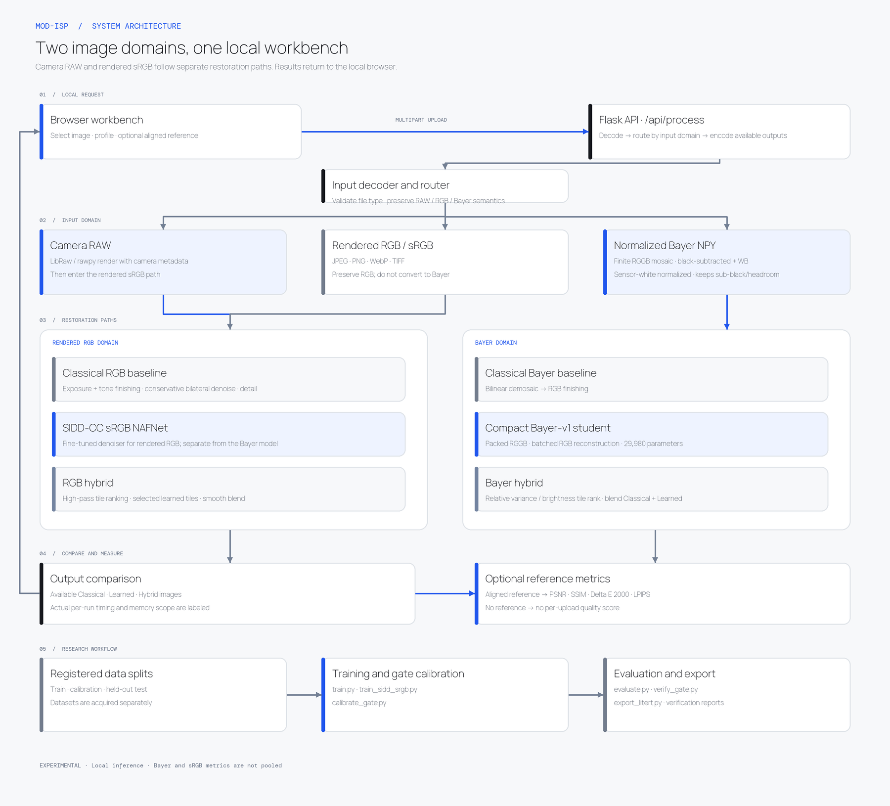

# System architecture

This diagram reflects the implemented code paths. The Bayer restoration model, sRGB denoiser, and camera-managed RAW renderer are separate paths; they are not interchangeable models.

## Runtime boundaries

- Uploads are processed by the local Flask app. The image API is not a hosted service.
- The Bayer checkpoint is cached after first load. Same-shaped Bayer tiles run in batches of 256 on Apple MPS and 128 on CPU, instead of one model call per tile.
- Camera RAW is rendered through LibRaw using camera metadata; the Bayer model is intentionally not applied to camera RAW without camera-specific paired validation.
- `.npy` Bayer input must be a finite, black-subtracted, white-balanced 2-D RGGB mosaic. Values in `[-0.5, 8]` are accepted so sub-black noise and white-balance headroom are preserved; the array must already have sensor-white normalization and white balance applied.
- SIDD-CC Bayer training uses the raw MAT arrays and per-capture CFA/AsShotNeutral metadata, with the aligned SIDD-CC sRGB image as the reconstruction target. The held-out SIDD-CC RAW test MAT files are not used because matching per-capture training metadata is not supplied in that test package; scene-disjoint training-split captures are reserved for validation and gate calibration instead.
- Rendered RGB stays in an RGB denoising/finishing path and is never mosaiced for inference.
- When a matching, aligned reference is supplied, metrics compare each returned output to that reference. Without one, quality metrics are absent.
- Normalized Bayer Hybrid uses a RAW-feature gate to select 56×56 Bayer tiles for neural restoration and blends those with the classical result. After switching the Bayer classical renderer to MHC, actual verification of the currently loaded production-checkpoint gate on 36 validation center crops routed 77.56% of tiles, lost 1.168 dB PSNR, and measured 23.88 ms Hybrid vs 18.41 ms Learned median warm latency. Recalibrated 256px Ridge and 512px ExtraTrees policies also failed the quality-loss bound. A separate 2024-inspired-student MHC + ExtraTrees candidate passed PSNR loss at −0.440 dB but routed 99% and was slower (89.1 vs 38.5 ms). No gate has a measured quality-safe efficiency win; all remain experimental. Route percentage is not a measured MAC reduction.
- RGB and camera-managed RAW Hybrid reuse the Learned output, so their Hybrid latency is incremental composition cost rather than standalone inference or compute savings.

## Source map

| Concern | Files |
|---|---|
| Web UI and API | `app.py`, `templates/index.html`, `static/` |
| Bayer decoding and classical ISP | `isp.py` |
| Compact Bayer model | `model.py` |
| Training / teacher distillation | `train.py`, `metaisp2023_adapter.py` |
| sRGB denoiser training | `train_sidd_srgb.py`, vendored NAFNet definition under `third_party/` |
| Evaluation / gate / export | `evaluate.py`, `calibrate_gate.py`, `verify_gate.py`, `export_litert.py` |
